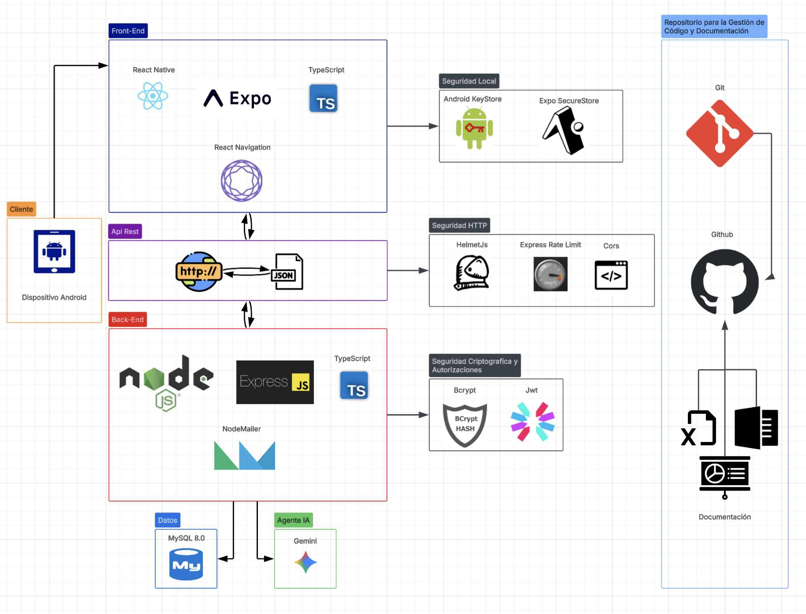
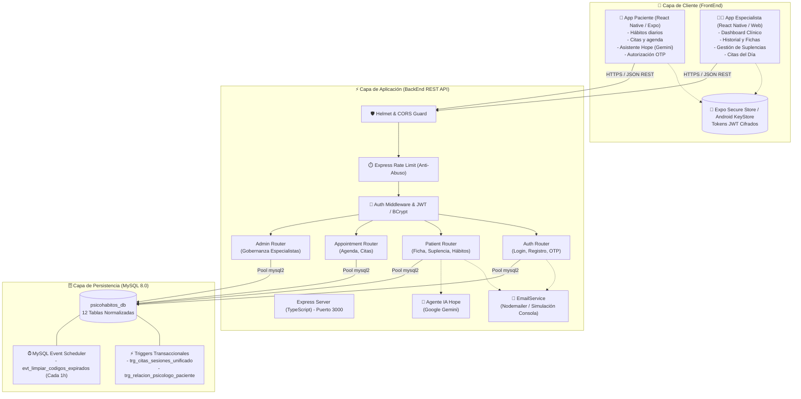

# 🧠 PsicoHábitos

> **Plataforma móvil y web de acompañamiento psicoterapéutico continuo, gestión clínica y monitorización de hábitos diarios entre sesiones.**

[](LICENSE)
[](https://nodejs.org/)
[-blue.svg)](https://expo.dev/)
[](https://www.mysql.com/)
[](https://www.typescriptlang.org/)
[](#cumplimiento-normativo-y-seguridad-clínica)

---

## Índice
1. [Descripción del Proyecto](#descripción-del-proyecto)
   - [¿Qué hace?](#qué-hace)
   - [¿A quién va dirigido?](#a-quién-va-dirigido)
   - [¿Qué problema resuelve? Contexto y Estadísticas](#qué-problema-resuelve-contexto-y-estadísticas)
   - [Solución Propuesta](#solución-propuesta)
2. [Tecnologías Utilizadas](#tecnologías-utilizadas)
3. [Arquitectura de la Solución](#arquitectura-de-la-solución)
   - [Descripción de la Arquitectura](#descripción-de-la-arquitectura)
   - [Diagrama de Arquitectura](#diagrama-de-arquitectura)
4. [Instrucciones de Instalación y Ejecución Local](#instrucciones-de-instalación-y-ejecución-local)
   - [Prerrequisitos](#prerrequisitos)
   - [Paso 1: Clonar el Repositorio](#paso-1-clonar-el-repositorio)
   - [Paso 2: Base de Datos MySQL 8.0](#paso-2-base-de-datos-mysql-80)
   - [Paso 3: Configuración del BackEnd y Variables de Entorno (.env)](#paso-3-configuración-del-backend-y-variables-de-entorno-env)
   - [Paso 4: Configuración y Ejecución del FrontEnd](#paso-4-configuración-y-ejecución-del-frontend)
   - [Paso 5: Aprovisionar Especialista de Prueba](#paso-5-aprovisionar-especialista-de-prueba)
5. [Integrantes del Equipo y Roles](#integrantes-del-equipo-y-roles)
6. [Metodología de Trabajo](#metodología-de-trabajo)
7. [Cumplimiento Normativo y Seguridad Clínica](#cumplimiento-normativo-y-seguridad-clínica)

---

## Descripción del Proyecto

### ¿Qué hace?
**PsicoHábitos** es un ecosistema digital compuesto por una aplicación móvil (React Native / Expo) y una API REST robusta (Node.js / Express con MySQL 8.0) diseñada para transformar la psicoterapia tradicional en un proceso activo, continuo y respaldado por evidencia diaria. 

Permite que pacientes registren día a día sus hábitos clave (hidratación, alimentación, sueño, ejercicio, niveles de estrés y ansiedad), accedan a recursos terapéuticos recomendados y conversen con un asistente de orientación emocional (**Hope**). A su vez, los especialistas en salud mental disponen de un panel clínico para agendar citas, visualizar métricas de evolución entre sesiones, gestionar suplencias médicas temporales y realizar traspasos de titularidad de pacientes bajo estricto consentimiento informado mediante códigos OTP.

---

### ¿A quién va dirigido?
El proyecto está orientado a dos públicos clave:

1. **Psicólogos y Especialistas Clínicos:** Profesionales de la salud mental que requieren recopilar información objetiva del paciente entre sesiones, gestionar agendas, supervisar alertas clínicas y colaborar de manera ética con colegas (titulares y suplentes).

2. **Pacientes en Psicoterapia, Atendidos por Psicologos Suscritos a Psicohabitos:** Personas que desean llevar un control activo de su bienestar psicológico, mantener adherencia a los compromisos terapéuticos y contar con acompañamiento interactivo entre consultas.

---

### ¿Qué problema resuelve? Contexto y Estadísticas

A partir de la crisis sanitaria desencadenada por el COVID-19, la población en Chile se ha visto inmersa en una profunda crisis de salud mental que continúa agudizándose:

* 📊 **4,2 Millones de personas** viven actualmente con alguna condición de salud mental en Chile *(Fuente: Zurich / The Value of Mental Health, 2026)*.
* 📈 **23% de la población chilena** se proyecta como afectada directamente al 2030 *(Fuente: Zurich / The Value of Mental Health, 2026)*.
* 🏫 **60% de los escolares** presentan sintomatología activa de depresión o ansiedad *(Fuente: Frontiers in Education, 2024-2026)*.

El proceso psicoterapéutico profesional consta de 5 fases estructuradas:
1. **Evaluación Inicial y Motivo de Consulta**
2. **Formulación de Caso y Diagnóstico Psicológico**
3. **Clasificación de Severidad y Establecimiento de Objetivos**
4. **Intervención Terapéutica y Sesiones Clínicas**
5. 🎯 **Seguimiento y Ajuste del Plan Terapéutico**

> ⚠️ **El Quiebre del Modelo Tradicional:**  
> La psicoterapia convencional suele verse limitada por la **falta de incidencias registradas entre consultas**. Lo que el paciente experimenta durante las semanas que transcurren entre una cita y otra queda supeditado a la memoria subjetiva en consulta, dificultando un diagnóstico preciso y un ajuste terapéutico oportuno.

---

### Solución Propuesta

**PsicoHábitos se posiciona en el punto 5 (*Seguimiento y Ajuste del Plan Terapéutico*)**, cerrando la brecha entre sesiones mediante:
* **Registro de Hábitos en Tiempo Real:** Métricas diarias de autocuidado emocional y fisiológico.
* **Trazabilidad y Gráficos Clínicos:** Los terapeutas evalúan tendencias y picos de ansiedad con datos concretos antes de cada sesión.
* **Gobernanza de Especialistas y Suplencias Éticas:** Mecanismos de reemplazo temporal y traspaso formal de expedientes sin perder continuidad asistencial ni violar la privacidad del paciente.

---

## Tecnologías Utilizadas

| Capa / Dominio | Tecnología / Herramienta | Propósito en el Proyecto |
| :--- | :--- | :--- |
| **Frontend Móvil & Web** | **React Native** + **Expo SDK 57** (React 19) | Aplicación multiplataforma (iOS, Android y Web) fluida y reactiva. |
| **Navegación Móvil** | **React Navigation v7** (`@react-navigation/native-stack`) | Gestión desacoplada de flujos de autenticación, pacientes y especialistas. |
| **Almacenamiento Local Seguro** | **Expo Secure Store** | Persistencia cifrada en hardware de credenciales y tokens JWT de sesión. |
| **Gráficos e Interfaz** | `react-native-gifted-charts`, `react-native-svg` | Renderizado interactivo de curvas de hábitos, estrés y evolución emocional. |
| **Backend REST API** | **Node.js** + **Express** + **TypeScript** | Servidor API REST con tipado estricto y arquitectura modular. |
| **Seguridad Backend** | **JWT**, **Bcryptjs**, **Helmet**, **Rate Limiting** | Cifrado de contraseñas, tokens de sesión blindados, control de cabeceras HTTP y protección DoS. |
| **Notificaciones y Correo** | **Nodemailer** | Envío de correos de activación y códigos OTP de 6 dígitos (con emulación automática en consola para desarrollo local). |
| **Agente Inteligencia Artificial** | **Google Gemini** | Asistente de contención y orientación emocional (Hope). |
| **Base de Datos** | **MySQL 8.0** | Almacenamiento relacional normalizado (12 tablas, integridad referencial estricta). |
| **Lógica en Base de Datos** | **Triggers Transaccionales & Event Scheduler** | Reglas de negocio ACID y depuración periódica legal de códigos OTP (`evt_limpiar_codigos_expirados`). |
| **DevOps y Entorno** | **Docker**, **Git / GitHub**, **Metro Bundler** | Contenedores locales, control de versiones colaborativo y empaquetado ágil. |

---

## Arquitectura de la Solución

### Descripción de la Arquitectura
La solución implementa una **Arquitectura en Capas Desacopladas (Clean Architecture / 3 Capas)**:

1. **Capa de Presentación (FrontEnd Móvil/Web):** Desarrollada con React Native y Expo. Implementa contextos de autenticación (`AuthContext`), roles dinámicos en caliente (`ProfileRoleHeader`) y llamadas tipadas a la API (`api.ts`).
2. **Capa de Negocio y Seguridad (BackEnd REST API):** Construida en Node.js/TypeScript. Incorpora middlewares de autenticación (`authMiddleware`), limitadores de tasa (`rateLimiter`), controladores por entidad clínica (`routes/`) y servicios auxiliares (`emailService`).
3. **Capa de Persistencia y Gobernanza (MySQL 8.0):** Modelo relacional blindado en la base de datos mediante triggers para evitar agendas huérfanas o citas sin suscripción activa, y un evento autónomo de mantenimiento cada 1 hora para depuración de credenciales temporales.

---

### Diagrama de Arquitectura

<p align="center">
  
</p>

<details>
<summary><b>📊 Ver flujo interactivo de componentes y persistencia (Mermaid)</b></summary>



</details>

---

## Instrucciones de Instalación y Ejecución Local

### Prerrequisitos
* **Node.js** v18 o v20 LTS instalado ([Descargar Node.js](https://nodejs.org/)).
* **MySQL 8.0** instalado localmente o mediante **Docker**.
* **Git** instalado.
* Dispositivo móvil Android con **Expo Go** instalado (opcional, para probar en celular) o navegador web moderno.

---

### Paso 1: Clonar el Repositorio

```bash
git clone https://github.com/Vani-79/PiscoHabitos-IA.git
cd PiscoHabitos-IA
```

*(O ingresa a la carpeta del proyecto si ya lo tienes descargado).*

---

### Paso 2: Base de Datos MySQL 8.0

1. Asegúrate de tener el servicio MySQL 8.0 iniciado (por ejemplo en el puerto `3306`).
2. Si prefieres usar **Docker**, puedes levantarlo con:
   ```bash
   docker run --name mysql_psicohabitos -e MYSQL_ROOT_PASSWORD=tu_contraseña_aqui -p 3306:3306 -d mysql:8.0
   ```
3. Ejecuta el script de creación de tablas e integridad referencial ubicado en la raíz del proyecto:
   ```bash
   mysql -u root -p < schema.sql
   ```
   *Esto creará la base de datos `psicohabitos_db` con sus 12 tablas, triggers y eventos de depuración automática.*

---

### Paso 3: Configuración del BackEnd y Variables de Entorno (.env)

Ingresa a la carpeta del backend e instala dependencias:

```bash
cd BackEnd
npm install
```

#### ⚙️ Generación Automática del `.env` (Recomendado)
Para evitar problemas al cargar el proyecto, creamos un script de configuración automática:

```bash
npm run setup:env
```

> 💡 **¿Qué hace este comando automáticamente?**  
> 1. Crea el archivo `.env` si no existe.  
> 2. **Genera y fija un `JWT_SECRET` criptográfico persistente:** Esto soluciona de raíz el error donde las sesiones se cerraban solas o daban error `401 Unauthorized` cada vez que el servidor se reiniciaba por cambios en el código.  
> 3. **Preconfigura la cuenta oficial de correo (`psicohabitos.ia@gmail.com`):** Deja listos el servidor SMTP, puertos y remitente corporativo. Para enviar correos reales, solo se debe pegar la Contraseña de Aplicación de 16 caracteres compartida internamente por el equipo. Si se deja vacía, el servidor automáticamente activa el **Modo Consola**, imprimiendo los códigos OTP de 6 dígitos en la terminal para pruebas locales sin dependencias externas.

#### 📝 Configuración Manual del `.env` (Alternativa)
Si prefieres crear el archivo `.env` manualmente a partir de `.env.example`:

```ini
# Configuración del servidor
PORT=3000
NODE_ENV=development
ALLOWED_ORIGINS=http://localhost:8081,http://localhost:3000,http://localhost:19006

# Conexión MySQL
DB_HOST=127.0.0.1
DB_PORT=3306
DB_USER=root
DB_PASSWORD=tu_contraseña_aqui
DB_NAME=psicohabitos_db
DB_TIMEZONE=-03:00

# Clave JWT persistente (cadena fija para evitar desconexiones)
JWT_SECRET=psicohabitos_jwt_secret_desarrollo_local_seguro_2026
JWT_EXPIRES_IN=7d

# -------------------------------------------------------------------------
# SERVICIO OFICIAL DE CORREOS (Gmail SMTP)
# -------------------------------------------------------------------------
SMTP_HOST=smtp.gmail.com
SMTP_PORT=465
SMTP_USER=psicohabitos.ia@gmail.com
SMTP_FROM="PsicoHábitos" <psicohabitos.ia@gmail.com>

# 🔑 Contraseña de Aplicación compartida por el equipo (16 caracteres):
# - Si pegas la clave: Se envían correos reales desde psicohabitos.ia@gmail.com.
# - Si la dejas vacía: Modo Consola (el código OTP se imprime en la terminal).
SMTP_PASS=tu_clave_de_aplicacion_de_16_caracteres
```

#### Iniciar el Servidor BackEnd:
```bash
npm run dev
```
Verás en consola:
```text
✅ [MySQL] Conexión establecida exitosamente con la base de datos psicohabitos_db
🚀 Servidor PsicoHábitos iniciado en http://localhost:3000
```

---

### Paso 4: Configuración y Ejecución del FrontEnd

Abre una nueva terminal, ve a la carpeta del frontend e instala dependencias:

```bash
cd FrontEnd
npm install
```

1. **Variables de entorno del FrontEnd:**  
   Copia el archivo de ejemplo a `.env`:
   ```bash
   cp .env.example .env
   ```
2. **Detección Automática de IP para Teléfonos Físicos:**  
   Al ejecutar `npm start`, el script `scripts/update-ip.js` detecta automáticamente la IP de tu red Wi-Fi local para que puedas escanear el código QR con **Expo Go** en tu celular sin tener que editar IPs a mano.

3. **Iniciar la aplicación:**
   ```bash
   npm start
   ```
   * Escanea el código QR con la app **Expo Go** en Android

---

### Paso 5: Aprovisionar Especialista de Prueba

Para probar el flujo clínico como psicólogo, puedes registrar un especialista inicial con el script incluido en el backend:

```bash
cd BackEnd
node scripts/register-psychologist.js "Claudia" "Rojas Mery" "claudia.rojas@gmail.com" 3
```
*Esto creará la cuenta con 3 meses de suscripción activa y enviará o simulará el correo de bienvenida.*

---

## Integrantes del Equipo y Roles

| Integrante | Rol en el Proyecto | Responsabilidades Principales |
| :--- | :--- | :--- |
| **Yosvani Alfaro** | **Product Owner / Desarrollador** | Definición de visión de producto, priorización del Product Backlog, levantamiento de requerimientos clínicos, arquitectura de datos relacionales en MySQL, desarrollo de endpoints REST y lógica de gobernanza clínica. |
| **Vanessa Arias** | **Scrum Master / Desarrolladora** | Facilitación y aseguramiento del marco de trabajo Scrum, gestión de ceremonias, remoción de impedimentos técnicos y de equipo, diseño de interfaces de usuario en React Native / Expo, navegación y experiencia del paciente. |

---

## Metodología de Trabajo

El equipo adoptó el marco de trabajo ágil **Scrum**, adaptándolo a un ciclo iterativo de entregas continuas:

* **Sprints:** Ciclos de desarrollo de 2 semanas enfocados en incrementos potencialmente entregables de valor clínico.
* **Ceremonias Scrum:**
  * **Sprint Planning:** Definición del objetivo del Sprint (*Sprint Goal*) y selección de Historias de Usuario del Product Backlog.
  * **Daily Scrum:** Sincronizaciones cortas para identificar avances, coordinar integraciones FrontEnd-BackEnd y despejar bloqueos (como sincronización de puertos, variables de entorno y pruebas locales).
  * **Sprint Review:** Demostración funcional del incremento (registro de pacientes, asignación de suplencias, flujos OTP y dashboard de hábitos).
  * **Sprint Retrospective:** Análisis de oportunidades de mejora técnica y metodológica en cada iteración.
* **Criterios de Calidad:**
  * **Definition of Ready (DoR):** Criterios claros de aceptación, diseño de vistas en wireframes y endpoints definidos antes de iniciar el desarrollo.
  * **Definition of Done (DoD):** Código probado en local, validaciones tipadas con TypeScript, triggers de base de datos verificados y documentación actualizada.

---

## Cumplimiento Normativo y Seguridad Clínica

El desarrollo de PsicoHábitos contempla altos estándares de protección de información sensible en salud:

1. **Ley 21.719 (Protección de Datos Personales y Datos Sensibles en Salud — Chile):**
   * **Principio de Consentimiento Informado:** La cesión o traspaso de fichas clínicas entre psicólogos requiere la confirmación explícita del paciente mediante un código OTP de un solo uso.
   * **Retención y Depuración Segura:** Mantenimiento auditado de 90 días para consentimientos clínicos y depuración automática de credenciales expiradas en MySQL.
2. **Principio de Mínimo Privilegio (RBAC Multi-Rol):**
   * Aislamiento criptográfico estricto entre roles (`paciente`, `psicologo`, `admin`).
   * Visualización en modo solo lectura (`[ Solo Lectura ]`) de notas clínicas cuando un psicólogo actúa como suplente temporal, resguardando la autoría legal del psicólogo titular.
3. **Persistencia Segura en el Dispositivo:**
   * Almacenamiento seguro mediante claves criptográficas en el enclave seguro del sistema operativo móvil (`expo-secure-store`).

---

<p align="center">
  <b>PsicoHábitos</b> — Transformando la salud mental con tecnología, ética y empatía. ❤️🧠
</p>
